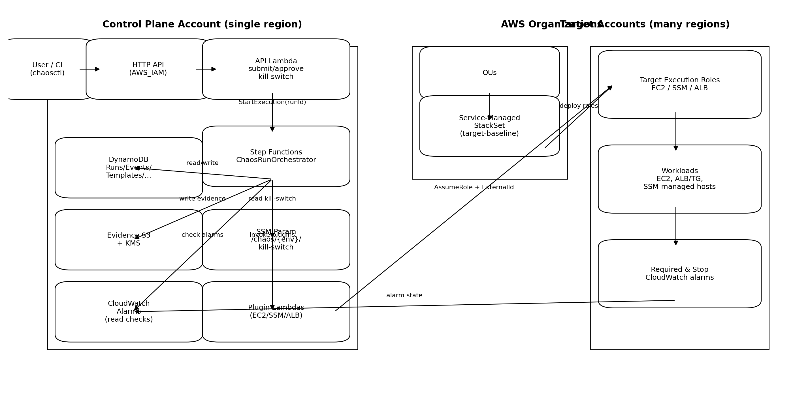
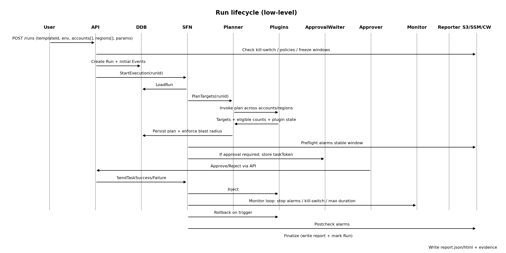

# ChaosForge — Multi‑Account, Multi‑Region Chaos Engineering on AWS (Go + AWS SDK)

ChaosForge is a **policy‑gated chaos engineering framework** designed for **one control‑plane account** to safely run experiments across **many target accounts and regions**.

It implements:

- **Control plane**: API + Step Functions orchestration + DynamoDB + evidence to encrypted S3
- **Target onboarding**: **AWS Organizations, Service‑Managed CloudFormation StackSets** to deploy target execution roles
- **Plugins**: pluggable experiment modules (EC2 / SSM / ALB reference plugins included)
- **Governance**: freeze windows, approvals, kill‑switch, alarm gates, blast‑radius limits, tag scoping
- **Ops tooling**: `chaosforge seed` (metadata seeding) + `chaosctl validate` (end‑to‑end validation)

---

## Architecture

> Diagrams are included as images (see `docs/diagrams/`) for maximum GitHub Markdown compatibility.


### High‑level diagram



### Low‑level run lifecycle (sequence)



---

## Repository layout

- `infra/cfn/control-plane.yaml` — control plane CloudFormation stack
- `infra/cfn/target-baseline.yaml` — StackSet template for target roles (**Service‑Managed**)
- `infra/asl/ChaosRunOrchestrator.asl.json` — orchestrator definition (ASL)
- `config/chaosforge.yaml.example` — **single YAML** for all environment/account/plugin/policy values
- `cmd/chaosforge` — ops tool (currently: `seed`)
- `cmd/chaosctl` — ops tool (currently: `validate`)
- `services/api` — HTTP API Lambda (run submission/approvals/kill-switch)
- `services/functions/*` — orchestrator helper Lambdas (planner, alarmchecker, etc.)
- `services/plugins/*` — reference plugins (EC2/SSM/ALB)
- `pkg/chaos/*` — shared libraries (model/store/policy/plugin contracts/evidence/notify)

---

## Prerequisites

1. An **AWS Organizations** environment (for service‑managed StackSets).
2. In the **management account**:
   - Enable trusted access for CloudFormation StackSets and AWS Organizations (required for service‑managed StackSets).
3. In the **control plane account**:
   - An S3 bucket to store Lambda artifacts (`ArtifactsBucket`)
4. A principal with permissions to deploy CloudFormation + StackSets and to seed/validate DynamoDB/SSM.

---

## Build and package

```bash
make tidy
make package
```

Outputs: `dist/*.zip`

Upload artifacts to your artifacts bucket/prefix:

```bash
aws s3 cp dist/ s3://YOUR_ARTIFACTS_BUCKET/YOUR_PREFIX/ --recursive --exclude "*" --include "*.zip"
```

The control-plane stack expects these keys under the prefix:

- `api.zip`
- `planner.zip`
- `alarmchecker.zip`
- `approvalwaiter.zip`
- `pluginexecutor.zip`
- `monitor.zip`
- `reporter.zip`
- `abort.zip`
- `plugin-ec2-stop.zip`
- `plugin-ec2-terminate.zip`
- `plugin-ssm-netem.zip`
- `plugin-ssm-stressng.zip`
- `plugin-alb-blackhole.zip`

---

## Deploy

### 1) Deploy the control plane stack

```bash
aws cloudformation deploy \
  --stack-name ChaosForge-ControlPlane \
  --template-file infra/cfn/control-plane.yaml \
  --capabilities CAPABILITY_NAMED_IAM \
  --parameter-overrides \
      OrgName=AcmeCorp \
      ArtifactsBucket=YOUR_ARTIFACTS_BUCKET \
      ArtifactsPrefix=YOUR_PREFIX
```

Fetch outputs:

```bash
aws cloudformation describe-stacks --stack-name ChaosForge-ControlPlane \
  --query 'Stacks[0].Outputs' --output table
```

### 2) Deploy target baseline with **Service‑Managed StackSets**

Use `infra/cfn/target-baseline.yaml` as the StackSet template.

Key parameters:
- `ControlPlaneAccountId` — control plane AWS account ID
- `OrgName` — must match `OrgName` used in the control-plane stack
- `RolePrefix` — default `ChaosTargetExecutionRole`

Deploy StackSet **to OUs** and **regions** you intend to target.

> The roles created in target accounts are assumed by plugins using:
> `ExternalId = <OrgName>/<Env>` (for example: `AcmeCorp/prod`).

---

## Configure (single YAML)

Edit: `config/chaosforge.yaml.example`

This file is the single source of truth for:
- target accounts + regions
- plugin registry (IDs/versions/lambda names, required role type)
- policies per env (freeze windows, approvals, blast radius, alarms)
- templates (approved experiments)

### Important policy fields

- `freezeWindows`: blocks new run submission during maintenance windows
- `requiredTags` / `denyTags`: enforces tag scoping and prevents “escape hatches”
- `blastRadiusLimits`: caps how many targets can be impacted (count and percent)
- `requiredAlarms`: must be stable before injection
- `stopAlarms`: if triggered, causes rollback/abort
- `approvalRequired`: typically true for `prod`
- `maxDurationSeconds`, `monitorIntervalSeconds`: monitor loop behavior

---

## Seed metadata (DynamoDB + kill-switch)

ChaosForge stores metadata in DynamoDB. The stack outputs the table names; the seeder reads outputs and writes items.

```bash
go build -o bin/chaosforge ./cmd/chaosforge

./bin/chaosforge seed \
  --config config/chaosforge.yaml.example \
  --stack ChaosForge-ControlPlane
```

Seeder behavior:
- Upserts **Accounts, Policies, Plugins, Templates**
- Initializes `/chaos/{env}/kill-switch = DISENGAGED` for each env found in `policies:`
- Optionally verifies reads after writes

---

## Validate end-to-end (`chaosctl validate`)

This command checks configuration correctness and (optionally) AWS-side deployment health.

```bash
go build -o bin/chaosctl ./cmd/chaosctl

./bin/chaosctl validate \
  --config config/chaosforge.yaml.example \
  --stack ChaosForge-ControlPlane
```

What it validates:
- Config semantics (IDs, plugin refs, env scopes, freeze windows, blast limits)
- Control plane stack outputs exist
- Tables exist and contain seeded entries
- Kill-switch parameters exist
- Orchestrator state machine is ACTIVE
- Plugin Lambda functions exist (best-effort)
- StackSet exists and is **SERVICE_MANAGED** with instances in expected regions
- Cross-account assume-role smoke tests + minimal “read” permissions

Useful flags:
- `--no-aws` (config-only)
- `--strict` (warnings become failures)
- `--check-ddb=false`, `--check-stackset=false`, `--check-assume=false`
- `--concurrency 16`

---

## API (HTTP API, AWS_IAM auth)

Endpoints:
- `GET /health`
- `POST /runs`
- `GET /runs/{runId}`
- `POST /approvals/{runId}/approve`
- `POST /approvals/{runId}/reject`
- `POST /killswitch/engage` body: `{ "env": "prod" }`
- `POST /killswitch/disengage` body: `{ "env": "prod" }`

Example (curl with SigV4 support, requires recent curl):

```bash
curl --aws-sigv4 "aws:amz:REGION:execute-api" \
  --user "$AWS_ACCESS_KEY_ID:$AWS_SECRET_ACCESS_KEY" \
  -H "x-amz-security-token: $AWS_SESSION_TOKEN" \
  -H "content-type: application/json" \
  -d '{"templateId":"ec2-stop-demo","env":"dev","accounts":["111111111111"],"regions":["us-east-1"],"params":{"targetTags":{"chaos:enabled":"true"},"maxTargets":1}}' \
  "https://<api-id>.execute-api.<region>.amazonaws.com/runs"
```

---

## Reference plugins

All plugins support **tag-based selection** (Option 1):
- `params.targetTags` (map) — used to find eligible targets
- `params.maxTargets` (int) — caps selection (policy blast-radius may further cap)

Included plugins:
- `ec2-stop@1` — stop/start EC2 instances
- `ec2-terminate@1` — terminate instances (rollback is best-effort)
- `ssm-netem@1` — tc netem latency/loss injection
- `ssm-stressng@1` — stress-ng injection (kill on rollback)
- `alb-blackhole@1` — deregister/register targets from a target group

---

## Notifications (optional)

ChaosForge can publish notifications:
- SNS: set `CHAOS_NOTIFY_SNS_TOPIC_ARN`
- Slack webhook: set `CHAOS_NOTIFY_SLACK_WEBHOOK_URL` or store it in SSM and point `CHAOS_NOTIFY_SLACK_WEBHOOK_PARAM`

Events emitted include:
- run created
- approval requested
- approved/rejected
- run finished (success/failure/aborted)

---

## Security notes

- Plugins assume target roles with **ExternalId** to prevent confused-deputy.
- Keep roles **least privilege** per plugin domain (EC2 / SSM / ALB).
- Prefer scoping selection with required tags like:
  - `chaos:enabled=true`
  - `env=dev|prod`
  - `service=<name>`
- Use alarms as guardrails:
  - required alarms stable before injection
  - stop alarms trigger rollback/abort

---

## Troubleshooting

- **Run stuck waiting for approval**:
  - Check Approvals table entry exists for runId
  - Approve via API `/approvals/{runId}/approve`
- **No targets found**:
  - Verify tags match `params.targetTags` and requiredTags
  - Ensure instances are in the specified regions/accounts and are eligible
- **AssumeRole fails**:
  - Verify StackSet instances succeeded in target accounts/regions
  - Verify ExternalId matches `<OrgName>/<Env>`
- **Kill-switch engaged**:
  - Set `/chaos/{env}/kill-switch = DISENGAGED` to allow new runs

---

## License

Internal use / reference implementation. Adapt and harden as needed.
